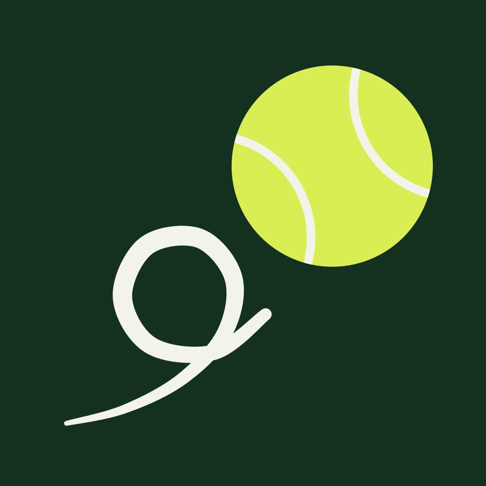

# 01 Logo

## Bildmarke

Die Bildmarke ist ein Tennisball am Ende einer Zoomies-Schleife: die hektische Runde des Hundes als eine lockere Kreidelinie, und der Filzball, dem er hinterherjagt. Die Linie beginnt dünn unten links, läuft voll durch die Schleife und schnalzt nach oben rechts aus; der Ball trägt die zwei Nahtbögen eines Tennisballs, um 30 Grad gedreht.

| Datei | Verwendung |
|---|---|
| `assets/logo/mark.svg` | Bildmarke auf Kleetinte-Quadrat. App-Icon, Avatar, dunkle Flächen mit Rand |
| `assets/logo/mark-dark.svg` | Transparent, Kreidelinie und Filzball. Für die Kleeschale und andere dunkle Flächen |
| `assets/logo/mark-light.svg` | Transparent, Tintenlinie, Filzball mit Tintenring. Für Kleeboden und Weiß |

Auf hellen Flächen bekommt der Ball einen Tintenring (18 Einheiten auf dem 1024er-Raster), weil Filz auf Weiß sonst keine Kante hält. Auf dunklen Flächen trägt er keinen Ring.

## Wortmarke

„frappies“ in Bricolage Grotesque ExtraBold, Laufweite -0.025em, einmal in Pfade gewandelt. Der i-Punkt ist der Tennisball. Die Geometrie liegt in `assets/logo/wordmark.json` (ViewBox 3992 × 1013, Ballmitte 2762.5/130, Radius 122) und wird in der App von `Wordmark.tsx` identisch gerendert.

| Datei | Verwendung |
|---|---|
| `assets/logo/wordmark-ink.svg` | Tinte, Ball mit Tintenring. Auf Kleeboden und Weiß |
| `assets/logo/wordmark-felt.svg` | Filz, Ball ohne Ring. Auf der Kleeschale |
| `assets/email/wordmark-felt@2x.png` | Für E-Mail-Clients, die kein SVG rendern |

Die Wortmarke ist immer klein geschrieben. In Fließtext heißt die Marke „Frappies“, groß.

## Kombination

Bildmarke und Wortmarke stehen nicht nebeneinander als Kombinationszeichen. Die Wortmarke trägt ihren Ball bereits. Wo Platz ist, steht die Wortmarke; wo nur ein Quadrat ist, die Bildmarke.

## Schutzraum

Um die Bildmarke: der Radius des Balls (auf dem 1024er-Raster 212 Einheiten, also etwa ein Fünftel der Kantenlänge) auf allen Seiten.
Um die Wortmarke: die Höhe des Balls (ein Viertel der Versalhöhe) auf allen Seiten.

## Mindestgrößen

| Zeichen | Bildschirm | Druck |
|---|---|---|
| Bildmarke | 24 px | 8 mm |
| Wortmarke | 20 px Höhe (etwa 80 px breit) | 6 mm Höhe |

Unter 24 px fällt die Naht weg: dann der Ball als reine Filzscheibe (`knockout`-Variante im Generator).

## Farben

Die Marke kennt genau drei Werte, in beiden Themes gleich: Tinte #14301F, Filz #D9EE52, Kreide #F2F4EC. Der Ball ist immer Filz. Die Linie ist Kreide auf Dunkel oder Tinte auf Hell. Eine einfarbige Variante (Android Monochrom) nutzt die Nahtform als Aussparung.

## Verbote

- Keine andere Farbe als Tinte, Filz, Kreide, auch nicht Wiesengrün oder Orange.
- Kein Verlauf, kein Schatten, keine Kontur um die Wortmarke.
- Ball nicht ersetzen, verschieben, vergrößern oder zusätzlich neben die Wortmarke setzen.
- Nicht drehen, nicht scheren, nicht spiegeln.
- Wortmarke nicht neu setzen; die Pfade sind das Zeichen, nicht die Schrift.
- Nicht auf Fotos, Mustern oder Illustrationen platzieren. Die Marke steht auf Tinte, Kleeboden oder Weiß.
- Kein Weiß als Füllung der Wortmarke; auf Dunkel ist sie Filz.

## App-Icon und Splash

| Datei | Beschreibung |
|---|---|
| `assets/app-icon/icon.png` | iOS 1024 × 1024, vollflächig Tinte, das OS maskiert |
| `assets/app-icon/android-icon-foreground.png` | Adaptive-Icon-Vordergrund, Marke auf 56 % skaliert für die sichere Zone |
| `assets/app-icon/android-icon-background.png` | Vollflächig Tinte |
| `assets/app-icon/android-icon-monochrome.png` | Weiß, Naht ausgespart |
| `assets/app-icon/splash-icon.png` | Marke transparent, auf Tinte #14301F (Splash-Hintergrund, 200 px Breite) |
| `assets/app-icon/favicon.png` | 48 px, Tintenkachel mit Radius 220/1024 |

## Quelle

Alle Dateien entstehen aus `assets/brand/generate.js` in der App (`bun run brand`). Geometrie dort ändern, nie die PNGs. Die Dateien hier sind die veröffentlichte Kopie. Ziel ist, den Generator in dieses Repository zu holen.
