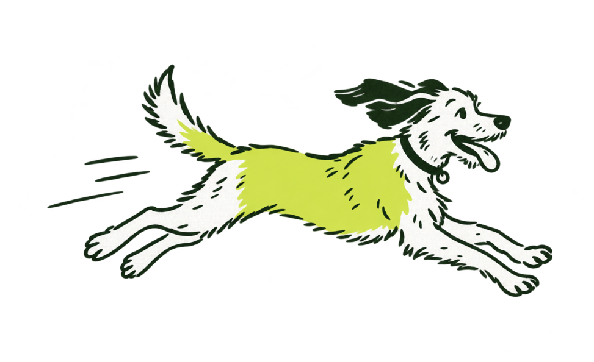

# 05 Illustration

Der Frappies-Hund ist ein struppiger, mittelgroßer Mischling, mit lockerer Pinsel-Tuschelinie in Kleetinte gezeichnet, mit ein paar flachen Filzflächen, ohne Schattierung, ohne Verlauf, ohne Textur. Ein Hund, acht Posen, jede mit einer Bedeutung. Er gehört zu Momenten, nie zu Datenzeilen.



## Stil

- Eine Linienstärke, lebendig und leicht wackelig, kein Clean-Vektor.
- Genau zwei Farben: Linie Kleetinte #14301F, Füllung Tennisball-Filz #D9EE52. Das Fell bleibt weiß (die Fläche darunter scheint durch).
- Eine große Filzfläche am Körper, wie ein Kleidungsstück in einem Editorial-Comic; der Rest ist Linie.
- Erwachsener Hund, natürliche Proportionen. Warm und witzig, nicht cartoonhaft, nicht kindlich.
- Transparenter Hintergrund, großzügiger Rand, kein Bodenschatten, kein Text.
- Requisiten in derselben Sprache: Ball mit Naht, Napf, Leine, Marke, Blatt Papier. Nichts Technisches (keine Laborgeräte, keine Kalender-Icons; das Briefing von damals ist verworfen).

## Die acht Posen

| Pose | Datei | Bedeutung | Einsatz |
|---|---|---|---|
| Zoomie | `zoomie.png` | Freude, Ankunft | Home-Schale, Onboarding, Willkommen, Website-Hero |
| Resting | `resting.png` | Nichts zu tun oder einzutragen | „Heute alles erledigt“, leere Erinnerungen |
| Ball | `ball.png` | Einladung anzufangen | Leere Akte, erster Hund, Premium-Seite |
| Listening | `listening.png` | Alles ruhig, horcht | Mitteilungen leer, Erinnerungen |
| Sniffing | `sniffing.png` | Liest ein Dokument | Befund scannen, KI-Auswertungen, Warten |
| Bowl | `bowl.png` | Futter | Futterplan |
| Lead | `lead.png` | Rausgehen | Tierarztpraxen, Tierarztbesuche, Gassi-Runden |
| Tag | `tag.png` | Identität | Hundemarken, Chipnummer |
| Papers | `papers.png` | Der Zettelhaufen vor Frappies | Website-Hero |

Requisiten und Flächen ohne Hund, nur für die Website: `meadow.png` (die Hundewiese: Hecke am Horizont, Grasbüschel, nur Linie) und `ball-grass.png` (der gezeichnete Ball im Gras, für die Ballskala auf der Wiese).

Alle Posen sind so beschnitten, dass sie etwa gleich hoch stehen. Seitenverhältnisse (Höhe ÷ Breite): papers 1004/1456, zoomie 594/973, resting 580/932, ball 622/871, listening 900/664, sniffing 593/900, bowl 756/900, lead 626/900, tag 837/657.

## Shell-Varianten

Jede Pose hat eine `*-shell.png`: helle Linie (Kreide), Fell ausgespart, dieselben Filzflächen. Sie gehört auf die Kleeschale und auf jede dunkle Fläche, weil Tintenlinien dort verschwinden. In der App wählt `Illustration` im Dunkelmodus automatisch die Shell-Variante. Die Originale mit weißem Fell gehören auf Weiß und Kleeboden.

Nie ein Original auf Dunkel, nie eine Shell-Variante auf Hell. Ausnahmen `papers-shell.png`, `sniffing-shell.png`, `bowl-shell.png`, `tag-shell.png`, `lead-shell.png`, `ball-shell.png` und `resting-shell.png`: Fell und Zettel bleiben weiß, nur die Außenlinie wird Kreide (siehe Entscheidungen unten). Ausgespart bleiben nur noch `zoomie-shell.png` und `listening-shell.png`.

Die Website nutzt seit dem 24.10.2026 einen eigenen Posensatz unter `assets/illustrations/website/`: derselbe Hund im Stil des freigegebenen Website-Entwurfs (dichterer Strich, Fell weiß mit Filzflecken, Halsband mit rundem Filzanhänger), erzeugt aus dem Entwurf und dann aus seiner Hero-Pose als Stilreferenz; dazu Requisiten (Grasbüschel, die Hundemarke „Zoomer“). Jede Datei trägt ihren Prompt und ihre Herkunft in der `.png.json` daneben. Neue Website-Posen entstehen hier aus `hero-dog.png` als Referenz. Ob die App-Posen diesem Stil folgen, ist offen.

Für Hilfe, Blog und Social liegen unter `assets/illustrations/web/` WebP-Kopien (höchstens 1600 px breit, die Wiese 2880 px), aus den PNG erzeugt; die Website kopiert nur diese.

## Wo sie hingehört

Momente: leere Zustände, Erstlauf, Paywall, Warten, Ankunft, Website-Hero, Store-Screenshots, Social-Beiträge.

Wo nicht: Datenzeilen, das Akten-Raster, Formulare, neben Zahlen, als Hintergrundmuster, als Icon-Ersatz.

Text läuft nie unter die Zeichnung; ihr Fußabdruck wird mit Padding reserviert (auf Home 80 bis 96 px rechts).

## Bewegung

Einzug mit Feder (`motion.spring.entry`): von links geschoben mit leichter Drehung, oder Skalierung von 0,85. Unter Reduced Motion steht sie sofort still. Siehe [07 Bewegung](07-bewegung.md).

## Neue Posen erzeugen

Jede Pose ist aus einer Quelle generiert und trägt ihre Herkunft eingebettet (`*.png.json`: Prompt, Modell, Datum, Referenz). Eine neue Pose entsteht nur mit dem Stil-Prompt unten, der Referenz `zoomie.png` als Bildvorlage, und bekommt ihre `*.png.json`. Danach die passende Shell-Variante. Eine neue Pose ist eine Markenentscheidung (siehe [CONTRIBUTING.md](../CONTRIBUTING.md)).

Stil-Prompt (Englisch, wörtlich übernehmen, nur den Absatz „Subject“ ersetzen):

```
Hand-drawn editorial illustration in exactly the style of the reference sheet: loose, confident brush-pen ink line of one even weight, slightly wobbly organic strokes, a few flat solid fill shapes, no shading, no gradients, no texture, no text, no ground shadow. Exactly two colours: line work in deep clover green-black #14301F and flat fills in tennis-ball felt chartreuse #D9EE52. Fully transparent background, the subject isolated with generous empty margin.

Subject: a scruffy medium-sized mixed-breed dog [POSE AND PROPS]. The dog's body has one large flat chartreuse fill patch (like the reference's filled garments), the rest is line. Adult, natural proportions, warm and witty but not cartoony or childish. [COMPOSITION], dog centred.
```

Kein Stock-Hundebild, kein zweiter Illustrationsstil, keine Fotografie als Ersatz. Wenn die Marke je Fotografie braucht, ist das eine Entscheidung mit eigenem Kapitel, nicht ein Bild in einem Beitrag.

## Entscheidungen

### 2026-10-21: Zettelhaufen, Hundewiese und Ball im Gras für die Website
Kontext: Die Landing Page war zu brav (namelessjames/frappies-web, Landing-Redesign). Der gewählte Entwurf öffnet auf dem Zettelchaos, das jede Hundehalterin kennt, und löst es auf der Hundewiese auf, wo Dringlichkeit Entfernung ist. Dafür fehlten eine Pose und zwei Requisiten. Fall 2 (bestehende Regeln ändern sich: Text in der Zeichnung, Shell-Variante mit weißem Fell, die Wiese als Fläche unter App-Karten).
Entscheidung: Neue Pose `papers.png` (Hund schnüffelt im Zettelhaufen) mit dem Stil-Prompt und `zoomie.png`/`sniffing.png` als Vorlage. Auf ihren Requisiten stehen drei handgeschriebene Wörter (Impfpass, Wurmkur??, Blutbild) in derselben Tuschlinie; sie erzählen das Chaos, sonst bleibt Text aus Zeichnungen draußen. `papers-shell.png` behält auf Wunsch des Inhabers Fell und Zettel weiß und färbt nur die Außenlinie in Kreide, damit der Hund auf der Schale wie im Entwurf steht. `meadow.png` ist die Wiese als reine Linie; auf ihr stehen nur die Karten der Ballskala, nie Fließtext. `ball-grass.png` ist der Ball der Ballskala als Zeichnung, nur auf der Wiese; in der App bleibt der Ball die Komponente. Tinte auf Filz bleibt Tinte auch in den Shell-Varianten.
Verworfen: Shell-Variante mit ausgespartem Fell (der Inhaber wollte die Linien dunkel und die Flächen weiß), Wörter als HTML über der Zeichnung (bricht beim Skalieren auseinander), ein Foto echter Zettel (zweiter Bildstil), die Wiese als Muster hinter Text (verletzt „Wo nicht“).
Web: namelessjames/frappies-web#13.

### 2026-10-21: Sniffing und Bowl auf Dunkel wie der Zettelhaufen
Kontext: Auf der Website stehen Sniffing und Bowl in der dunklen KI-Sektion, direkt nach dem Hero mit `papers-shell.png`. Zwei Behandlungen desselben Hundes auf demselben Grund wirkten wie zwei Hunde. Fall 2 (bestehende Shell-Varianten ändern sich; die App nutzt sie im Dunkelmodus).
Entscheidung: `sniffing-shell.png` und `bowl-shell.png` bekommen dieselbe Behandlung wie `papers-shell.png`: Fell weiß, innere Linien Tinte, Außenlinie Kreide. Die übrigen Shell-Varianten bleiben vorerst ausgespart, bis die App entschieden hat.
Verworfen: alle Shell-Varianten auf einmal umstellen (ändert jeden dunklen App-Zustand ohne Prüfung), nur die Website-Kopien ändern (die Website kopiert die Marke byte-genau).
Web: namelessjames/frappies-web#13.

### 2026-10-21: Tag, Lead, Ball und Resting auf Dunkel wie der Zettelhaufen
Kontext: Im Dunkelmodus der Website stehen Tag, Lead, Ball und Resting noch mit ausgespartem Fell neben Sniffing und Bowl mit weißem Fell. Der Inhaber will alle Hunde der Website gleich. Fall 2 (bestehende Shell-Varianten ändern sich; die App nutzt sie im Dunkelmodus).
Entscheidung: `tag-shell.png`, `lead-shell.png`, `ball-shell.png` und `resting-shell.png` bekommen dieselbe Behandlung: Fell weiß, innere Linien Tinte, Außenlinie Kreide. Zoomie und Listening folgen, wenn die App sie braucht.
Verworfen: nur die Website-Kopien ändern (die Website kopiert die Marke byte-genau).
Web: namelessjames/frappies-web#15.

### 2026-10-24: Posensatz der Website
Kontext: Der Website-Entwurf, den der Inhaber wählte, zeigte den Hund in einem dichteren Strich als die App-Posen. In der Plattenprüfung lehnte er die App-Posen für die Website ab („I want the comp dog illustration“) und nahm die aus dem Entwurf erzeugten an. Die Website kopiert Illustrationen byte-genau aus der Marke, also gehören die Dateien hierher. Fall 1 (ein neuer Posensatz, der zur Marke dazukommt).
Entscheidung: `assets/illustrations/website/` mit hero-dog, feature-dog, app-avatar, record-dog, scan-dog, listening-dog, meals-dog, premium-dog, closing-dog, feature-tag, grass-left, grass-right, grass-right-2 und die Filzkörnung `assets/textures/felt-grain.png`, alle mit Prompt-Sidecar. Die App-Posen bleiben, wie sie sind.
Offen: die App-Posen in diesem Stil neu zeichnen, damit App und Website einen Hund haben.
Web: namelessjames/frappies-web#17.

